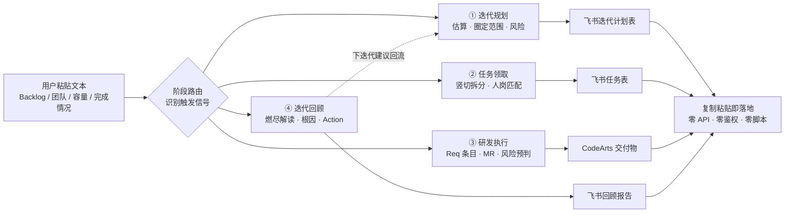

# agile-sprint-assistant · 敏捷迭代 AI 副驾

> 中型研发团队敏捷迭代的 AI 副驾：**飞书为协作面，华为云 CodeArts 为研发里**。
> 粘贴一段需求与团队信息，即可贯穿「迭代规划 → 任务领取 → 研发执行 → 迭代回顾」四阶段，
> 输出可直接粘贴到飞书多维表格与 CodeArts 的结构化产物。

   

---

## 这是什么

一个**纯语义 Skill**：没有脚本、不调用任何平台 API、无需鉴权配置。
它替代的不是「人手粘贴」，而是敏捷迭代中每两周重复一次、高度依赖经验的**人脑判断**——

- 这个 Story 该估 5 点还是 8 点？依据是什么？
- 这个迭代按团队容量能圈多少范围？
- Story 该怎么拆、分给谁、负荷是否均衡？
- 这段技术描述里藏着哪些风险信号？
- 每条验收标准该覆盖哪些正常 / 边界 / 异常测试场景？
- MR 该请谁 Review、重点看什么？
- 燃尽图这个形态说明什么？阻塞的流程根因在哪？

**每条建议都附依据，最终由人拍板。**

## 解决什么问题

目标团队：**5~15 人、采用敏捷 / Scrum 模式**的中型研发团队，以飞书多维表格作为迭代定义与任务领取的协作入口，以华为云 CodeArts（Req + Repo + Pipeline）作为研发效能平台。

典型用户是一位身兼 Scrum Master 与技术骨干的迭代负责人：熟悉敏捷理念，却疲于每迭代重复的估算、拆分、填表、复盘，希望有一个**懂敏捷领域知识、懂飞书表格格式、懂 CodeArts 研发规范**的副驾，而不是又一个需要配置鉴权的集成工具。

## 四阶段能力

| 阶段 | 输入 | 输出 | 边界 |
|------|------|------|------|
| ① 迭代规划 | Backlog + 团队成员 + 迭代容量 + 历史速率（可选） | 故事点估算依据 + 圈定范围 + 风险依赖清单 + 燃尽起点 + 飞书迭代表字段 | 估算给建议附依据，不代决 |
| ② 任务领取 | 迭代内 Story + 成员技能矩阵 + 当前负荷 | 竖切子任务（≤1 人日）+ 领取建议 + 负荷均衡表 + 未分配预警 | 分配给建议，由人认领 |
| ③ 研发执行 | 已领取的单个 Story | CodeArts Req 条目 + 分支命名 + 提交规范 + MR 模板 + 技术风险识别 + AC→测试用例骨架 + 动态自测清单 + Code Review 建议 | 只生成格式，不调 API 录入 |
| ④ 迭代回顾 | 完成情况 + 燃尽数据 + 流水线质量 + 阻塞记录 | 飞书回顾报告 + 燃尽形态解读 + 5Whys 根因 + 改进 Action（含 Owner + 验证方式） | Action 必须可验证 |

### 工作流全景



## 快速开始

**触发词**：迭代规划、sprint planning、排迭代、排个期、帮我排、这周怎么排、故事点估算、分活、分任务、任务领取、认领、开分支、提 MR、迭代回顾、复盘上周、复盘一下、燃尽图、需求插单、范围变更。

一个最小输入示例：

```text
【迭代】Sprint-01，2026-11-02 ~ 2026-11-13，2周
【团队】6人新团队，无历史速率
- 陈思远 Scrum Master/全栈（Node.js/React/飞书自动化）
- 林浩然 后端（Java/Spring Boot/MySQL/Redis）
- 赵雨晴 后端AI（Python/FastAPI/NLP/LLM/向量检索）
- 周子轩 前端（React/TS/Ant Design Pro）
- 孙梦琪 前端（React/TS/ECharts/可视化）
- 吴俊杰 测试（Pytest/Jest/Postman/性能）
每人可投入10工作日，无请假
【Backlog】
S-101 工单自动分类 P0：工单提交后按标题+描述自动分类到预设类目，支持人工修正
S-102 知识库检索增强 P0：客服处理工单时从知识库检索Top5相关文档片段辅助回复
...
请帮我做迭代规划。
```

Skill 识别「迭代规划」后路由 Phase 1，输出容量表、故事点估算依据、圈定范围、风险依赖清单与燃尽起点；复制 Markdown 表格粘贴到飞书多维表格首行，列自动识别。

完整四阶段输入输出见 [`demos/ai-ticket-assistant-sprint01.md`](demos/ai-ticket-assistant-sprint01.md)。

## 项目结构

```text
agile-sprint-assistant/
├── SKILL.md                          # 入口：四阶段路由 + 工作流 + 6 条核心原则 + 资源导航 + 安全约束
├── references/
│   ├── agile-knowledge.md            # 敏捷领域知识：Scrum / Modified Fibonacci / 速率 / 容量 / INVEST / 竖切 / DoD / 燃尽5形态 / 5Whys / 插单处理
│   ├── feishu-schema.md              # 飞书多维表格字段定义（迭代表 / 任务表 / 回顾文档）+ 粘贴格式
│   └── codearts-schema.md            # CodeArts 规范：Req 条目 / 分支命名 / Conventional Commits / MR 模板 / 风险识别 / 测试骨架 / 自测裁剪 / Review 建议
├── assets/
│   ├── sprint-plan-template.md       # Phase 1 输出模板
│   ├── task-assignment-template.md   # Phase 2 输出模板
│   ├── codearts-deliverables-template.md  # Phase 3 输出模板
│   └── retrospective-template.md     # Phase 4 输出模板
├── evals/
│   └── test-cases.md                 # 6 个测试场景：四阶段 Happy Path + 无历史速率 + 模糊输入
├── demos/
│   └── ai-ticket-assistant-sprint01.md   # AI 工单助手 Sprint-01 全流程演示
└── contest/                          # 参赛材料：参赛说明 / 演示脚本 / 录屏文案
```

## 设计原则

1. **阶段路由** — 先识别处于四阶段中的哪一阶段，再加载对应工作流，避免上下文臃肿
2. **格式对接而非系统集成** — 输出飞书字段结构与 CodeArts 条目模板，由人复制粘贴落地，不做 Webhook / API 自动写入
3. **建议而非代决** — 估算、分配、圈定范围只给建议与依据，最终由人拍板（敏捷的核心是人）
4. **数据全由用户输入** — 不依赖任何外部动态数据，不伪造团队 / 需求数据
5. **输入不完整时显式确认** — 必要字段缺失先提示补全；非必要缺失按保守默认处理并标注假设，不静默编造
6. **大规模输入分批处理** — Backlog 超过 30 个 Story 时，建议按优先级筛选 Top N 或分批规划

## 边界场景

- **无历史速率**：按容量 × 0.6 保守系数估算，强标注「速率待校准」，建议积累 3 轮后改用近 3 轮平均速率
- **模糊输入**：必要字段缺失（无优先级 / 无可投入天数）时显式提示补全，可处理部分先给标注假设的初步结果
- **大规模 Backlog**：超过 30 个 Story 建议筛选 Top N 或分批规划，避免信息过载
- **迭代中插单**：按「插单评估三问」（是否 P0 / 能否拆出最小切片 / 谁有 buffer）评估，给出插入、换出或进下迭代建议，PO 拍板

## 安全约束

- **禁止**调用飞书 / CodeArts 任何 API 或 Webhook，不做自动写入
- **禁止**伪造团队成员工时、需求数据、流水线质量等现实数据
- **禁止**替人做最终决策
- 输出标准 Markdown 表格，每个建议附依据；无明确历史速率时显式提示并给出保守默认

## 质量记录

经 2 轮隔离盲评：

| 轮次 | 评分 | Verdict | 处理 |
|------|------|---------|------|
| R1 | 86 | PASS_WITH_FIXES | 3 项 P2 全修复：补充输入处理策略、evals 增加边界与模糊输入场景 |
| R2 | 96 | PASS | 2 项 P2 全修复：补充跨迭代依赖规则、大规模 Backlog 限制 |

P0 / P1 问题为 0，Ship Decision = YES。

## 比赛背景

本项目为 **2026 华为开发者大赛 · 小红书 Skill 创新赛** 参赛作品，方向为赛题三「AI 效率达人」研发创新方向。
Skill 需同时发布到华为云 Skill 市场与小红书 Skill 市场。
